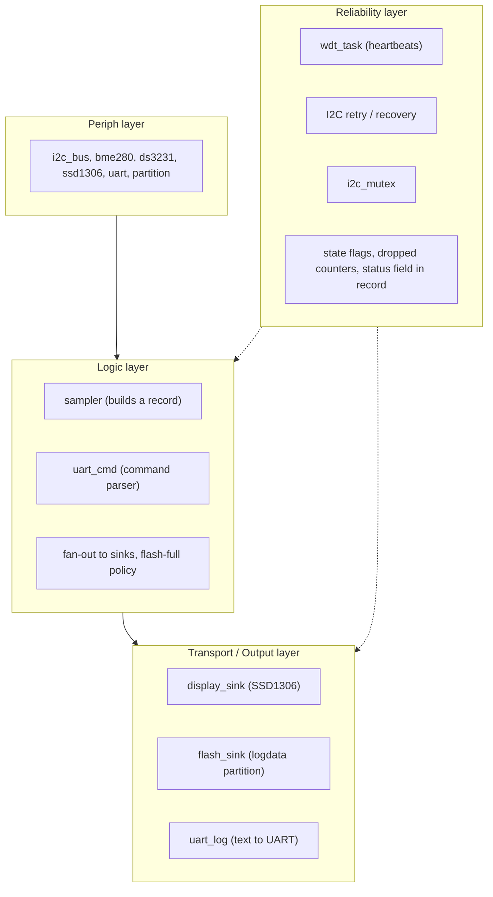
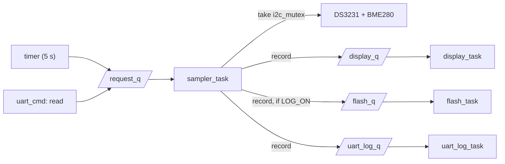
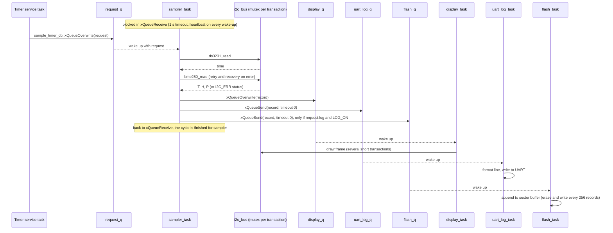
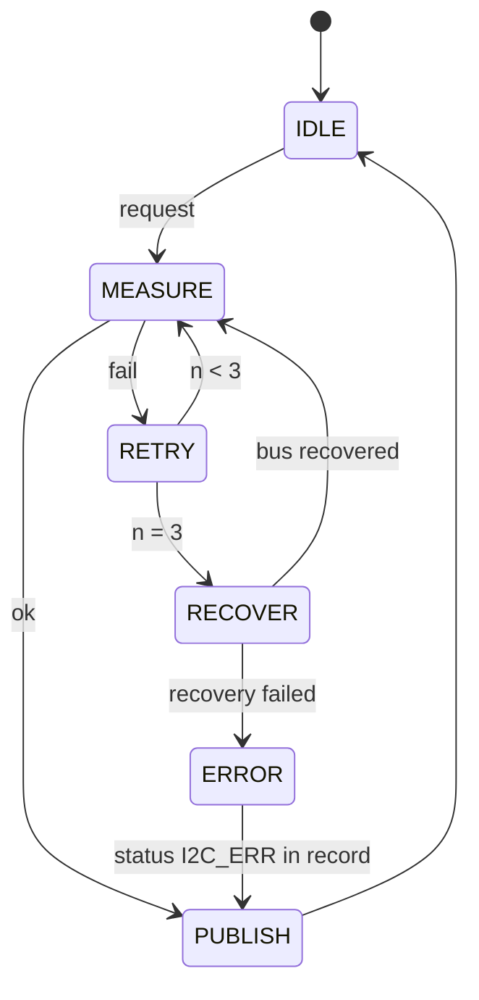
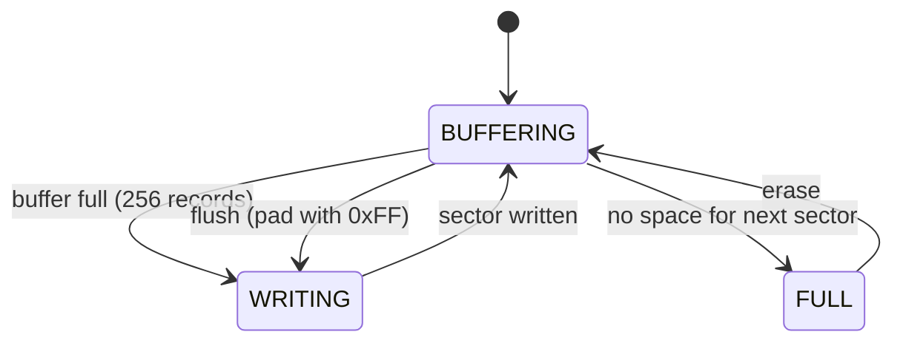

# Environment Data Logger (ESP32-S3, ESP-IDF, FreeRTOS)

An environment data logger on ESP32-S3: it measures temperature, humidity and pressure (BME280), takes time from a DS3231 RTC, shows values on an SSD1306 OLED, stores records in internal flash, accepts commands over UART, and reboots through a watchdog if a critical task hangs.

The architecture is designed so that new sensors (sources) and new storage back-ends (sinks) can be added as separate modules without rewriting the core.

## Scope

| Stage | Contents |
|---|---|
| **Stage 1** | measurement timer and request queue, BME280 + DS3231, display, internal flash, UART commands, WDT, I2C retry/recovery. No SD card |
| **Stage 2** | light sensor (ADC), move to channels and sources, `net_service`, MQTT |

---

## Step 1. Peripherals

| Peripheral | Purpose | Used by |
|---|---|---|
| I2C master | BME280, DS3231, SSD1306 on one bus | `sampler`, `display` |
| UART0 | commands (RX), log and replies (TX) | `uart_cmd`, `uart_log` |
| Flash partition `logdata` | binary log | `flash_sink` |
| Software timer | measurement cadence (5 s) | callback → `sampler` |
| Task WDT | reboot on hang | `wdt_task` |
| ADC1 *(stage 2)* | light sensor | `light_src` |
| Wi-Fi *(stage 2)* | MQTT | `net_service` |

---

## Step 2. Architecture layers

---

## Step 3. FSM and flow

### One measurement cycle

### Sequence of one cycle

Each task finishes its own part independently and returns to waiting on its own queue. There is no global "end of cycle" event.

### Sampler FSM

Bus recovery (9 SCL pulses, driver restart) is attempted once per request. If the measurement still fails afterwards, the record is published with the `I2C_ERR` status.

### Flash sink FSM

### Global flags (event group `flags`)

`LOG_ON`, `FLASH_FULL`. Written by `uart_cmd` and `flash_sink`, read by `sampler` and the display.

---

## Step 4. Queues, mutexes, semaphores

| Where | Primitive | Why |
|---|---|---|
| timer / `uart_cmd` → `sampler` | **Queue** `request_q` (length 1, `xQueueOverwrite`) | arrow between tasks; redundant requests merge |
| `sampler` → `display` | **Queue** `display_q` (length 1, overwrite) | only the latest value matters |
| `sampler`, `uart_cmd` → `flash` | **Queue** `flash_q` (8–16) | flash erase/write blocks |
| `sampler` → `uart_log` | **Queue** `uart_log_q` (8) | UART is slower than the sensor cycle |
| I2C bus | **Mutex** `i2c_mutex` | two paths to one resource: `sampler` and `display` |
| UART TX | **Mutex** `uart_mutex` (see open questions) | two paths: `uart_log` and `uart_cmd` replies |
| task heartbeats → `wdt_task` | **Event group** `hb_group` | several tasks signal one supervisor |
| `LOG_ON`, `FLASH_FULL` | **Event group** `flags` | simple boolean states read by several tasks |
| `logdata` partition | none | only `flash_task` touches it |
| Semaphore | not needed yet | will be needed for the DS3231 SQW interrupt (binary semaphore or task notification from an ISR) |

---

## Tasks and responsibilities

| Task | Priority | Does | Waits on |
|---|---|---|---|
| `sampler_task` | 5 | measurement, record building, fan-out to sinks | `request_q` |
| `flash_task` | 4 | sector RAM buffer, erase/write, flush/erase | `flash_q` |
| `display_task` | 3 | draws latest values and status | `display_q` |
| `uart_log_task` | 2 | prints records and replies | `uart_log_q` |
| `uart_cmd_task` | 2 | receives and executes commands | UART driver events |
| `wdt_task` | 2 | feeds the TWDT if critical tasks are alive | `hb_group` |

UART commands: `help`, `status`, `read`, `flush`, `erase`, `dump`, `log on|off`, `period N`. They act in place: `read` puts a request into `request_q`, `flush`/`erase` put a message into `flash_q`, `log on|off` changes a flag, `period N` changes the timer period.

---

## Decisions and open questions

**Decided**
- Two separate UART tasks: `uart_log` (TX) and `uart_cmd` (RX). Merging them may be reconsidered later.
- No separate `command_queue` and no Manager task.
- No Light Sleep.

**Open**
- Whether `uart_mutex` is needed. It depends on whether the UART driver in the chosen ESP-IDF version protects writes. If all command replies go through `uart_log_q`, the mutex is unnecessary.
- Critical tasks for the WDT: currently `sampler` and `flash`. Display and UART are intentionally non-critical.

---

## Stage 2 plan

1. Light sensor on ADC1 and the move to channels and sources (`light_src`, channel table, validity mask).
2. `net_service` and `mqtt_sink` with defined behaviour when the network is down.
3. SD sink if needed.